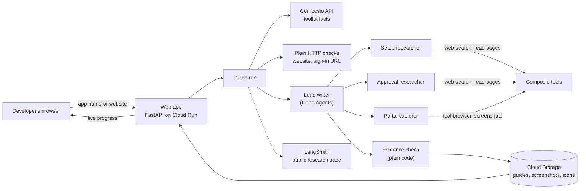

# OAuth App Guides

Before your AI agent's users can connect an app like HubSpot or Gmail, you often have to register an OAuth app with that provider, and sometimes get it approved. This project tells you, for any app, what that takes:

- **How hard it is**: easy, medium or hard.
- **How long it takes**: until it works for you, and until any customer can connect, including review waits.
- **What can block you**: install caps, reviews, security assessments, limits on unreviewed apps.
- **Who does what**: which steps you do yourself and which an agent can do.

Every claim in a guide is marked **tested** (seen during research), **sourced** (stated on the linked page) or **uncertain** (check before relying on it).

**Live:** https://oauth-guides-968299856642.us-central1.run.app
**Source:** https://github.com/aravindsriraj/oauth-app-guides

## Try it in a minute

1. **Open a guide from the library:**
   - Linear (easy);
   - Slack, HubSpot or Pipedrive (medium);
   - Gmail (hard).

   The summary on the right answers how hard it is and how long it takes. The numbered steps show exactly what to do.
2. **Research a new app.** Type a name or website into the search box, or click one of the "Try" suggestions. You'll watch three agents work in parallel, live screenshots included, and get a shareable guide in 3–5 minutes. This works for apps Composio doesn't cover too, such as Strava.

## How it works



1. **Find the app in Composio.** Code looks the app up in Composio's API. That says whether Composio already provides an OAuth app, and gives the exact redirect URL and default scopes. The model never guesses those.
2. **Run plain checks.** Code confirms the website loads and calls the provider's sign-in URL with a made-up app ID, to see whether it rejects unknown apps. These are the "tested" facts that need no AI.
3. **Research in parallel.** A lead writer briefs three specialists at once:
   - one reads the setup docs;
   - one reads the review rules, waits, costs and install caps;
   - one opens the developer pages in a real browser and takes screenshots.

   They research through Composio's search, page-reading and browser tools, using Gemini (`gemini-3.8-flash`).
4. **Check the evidence.** The lead writer turns the findings into a guide, then code checks it:
   - a claim stays "sourced" only if its page was actually read during this run, and any number in it appears on that page;
   - steps are never "tested", because the agents never log in;
   - dead links make their claims "uncertain".
5. **Save and share.** The guide goes to Cloud Storage with its own link, a Markdown version, and a public trace of every search and page behind it.

## Key decisions

- **Measure the whole path, to "any customer can connect".** Creating the app is the easy part. The surprises come later: Gmail's security assessment, HubSpot's 25-install cap, Slack's limits on apps outside its Marketplace. Every guide must state the install cap and any reduced limits before review.
- **Composio's facts are ground truth.** Each guide opens with "Do you need your own app?", answered from Composio's API, and ends with the hand-off to a Composio auth config.
- **Agents stay on public pages.** They read, search and browse, but never sign up, log in or submit forms. That's the honest line between what an agent can try and where you take over.
- **Code enforces honesty, not prompts.** Each evidence rule exists because an audit caught the model making that mistake (see [VERIFICATION.md](VERIFICATION.md)).
- **Fix the pipeline, never the guide.** When the audit found an error, we changed a prompt or a rule and regenerated. Guides are never hand-edited.
- **Keep it small.** One Cloud Run instance, one live run at a time, and up to 30 new guides a day, at roughly $0.12–0.16 of Gemini usage each.

## How we know the guides are right

We checked every sourced claim in the five library guides against the page it cites: **143 claims, 62% confirmed, 31% partly supported, 8% not on the cited page, 0 wrong.**

An earlier round of checks found real errors, each fixed in the pipeline:
- Slack's 2025 rate limits for apps outside its Marketplace were missing;
- HubSpot's 25-install cap was missed in one run;
- the "your own app gets your own rate limits" reason was wrong for Linear and Pipedrive;
- Gmail's sign-in check was misread.

Library guides carry an "Audited" badge. Guides generated by visitors say they haven't been checked by a person yet. Details are in [VERIFICATION.md](VERIFICATION.md).

## Limitations

- **Nothing behind a login is tested.** No app was submitted for review, so wait times are the providers' own estimates.
- **"Sourced" means the page was read and cited.** Code checks numbers, scopes and rate-limit claims against the page, but not the meaning of every sentence.
- **An agent can miss a fact in one run and find it in the next.** The required install-cap and limits answers cover the facts that matter most.
- **One instance keeps live runs in memory.** A redeploy during a run loses that run; saved guides are unaffected.
- **5 guides, not 100.** Scaling means running the command-line tool over Composio's OAuth toolkits, at about 4 minutes and $0.15 each.

## Run it yourself

You need Python 3.13, [uv](https://docs.astral.sh/uv/), a Google Cloud Storage bucket, and `gcloud auth application-default login`.

```bash
uv sync
export GEMINI_API_KEY=... COMPOSIO_API_KEY=... BUCKET=your-bucket
export LANGSMITH_API_KEY=... LANGSMITH_TRACING=true LANGSMITH_PROJECT=oauth-guides   # optional: public trace links

uv run python -m app.check                   # self-check of the evidence rules
uv run python -m app.pipeline "Linear"       # research one app from the command line
uv run uvicorn app.main:app --port 8080      # the web app, at http://localhost:8080
```

To deploy to Cloud Run, keep the keys in Secret Manager. The bucket needs public read access for screenshots and icons.

```bash
gcloud run deploy oauth-guides --source . --region us-central1 --allow-unauthenticated \
  --timeout 900 --max-instances 1 --no-cpu-throttling --memory 1Gi --service-account <sa> \
  --set-secrets GEMINI_API_KEY=gemini-api-key:latest,COMPOSIO_API_KEY=composio-api-key:latest,LANGSMITH_API_KEY=langsmith-api-key:latest \
  --set-env-vars BUCKET=<bucket>,LANGSMITH_TRACING=true,LANGSMITH_PROJECT=oauth-guides,DAILY_CAP=30
```

## What's where

| Path | What it does |
|---|---|
| `app/main.py` | Web pages, live progress, limits |
| `app/pipeline.py` | One guide run: plain checks, research, evidence check, save |
| `app/agent.py` | The four agents, their prompts, and their Composio tools |
| `app/guide.py` | The guide's data model, the evidence rules, and the plain checks |
| `app/check.py` | Self-check for the evidence rules |
| `app/templates/` | The pages, plus the Markdown version of a guide |
| `verification/` | The audited guides and scripts that re-run the checks |
| `VERIFICATION.md` | How each guide was checked, and what was found and fixed |
